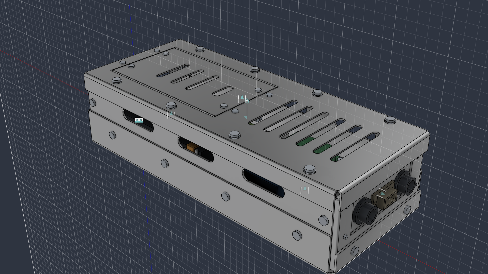
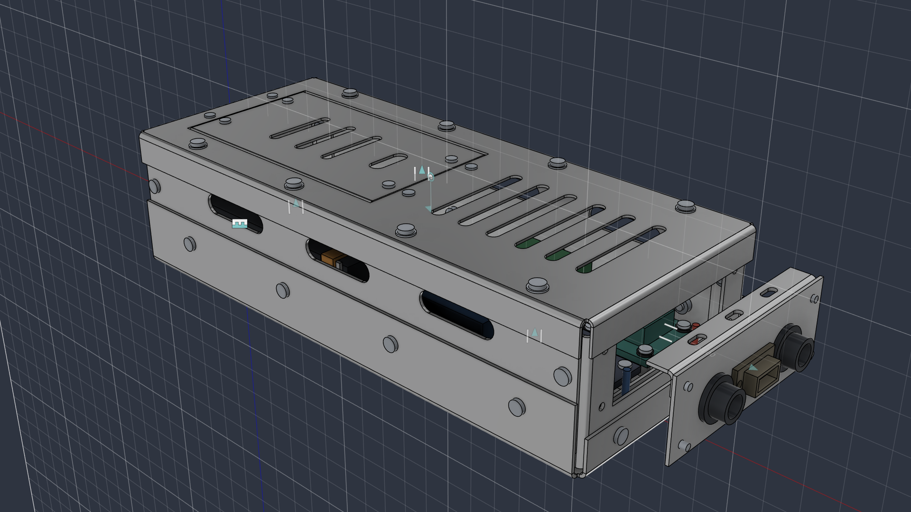

# Modular UAV Avionics Bay & Sheet Metal Enclosure Package

A complete 8-subsystem parametric sheet metal avionics bay and equipment mounting cassette designed in **Autodesk Fusion**, inspired by the Parrot Disco civilian fixed-wing UAV.

> **Engineering Notice:** Conceptual educational mechanical design. Not an OEM replacement component, not structurally certified, and not flight-qualified.

## Design & Engineering Highlights
- **Modular Sheet Metal Architecture:** `180.0 × 75.0 × 45.0 mm` Aluminum 5052-H32 enclosure (`1.0 mm` chassis tray, side rails, bulkheads, and removable equipment deck; `0.8 mm` top cover, hemmed service access hatch, and cable management channels).
- **Zero-Collision Assembly & Kinematics:** 15 unique sheet metal components, 121 instanced A2-70 stainless steel fasteners, 5 working kinematic joints (top cover lift, hinged battery service hatch, removable avionics deck, battery extraction, and rear connector panel slide), and 0 interference collisions across all internal subsystems.
- **Mass & Center of Gravity Analysis:** `231.8 g` verified CAD structure and hardware mass (`529.8 g` equipped concept including assumed 3S 2700 mAh LiPo and avionics envelopes) with balanced 3D center of mass (`X = 83.3 mm, Y = -4.6 mm, Z = 17.1 mm`).
- **Complete Fabrication & Drafting Package:** 15 1:1 millimetre laser-cutting DXFs (`manufacturing/dxf/`), multi-sheet Excel BOM (`bom/BOM.xlsx`), 17-sheet ISO 128 orthographic & cross-hatched section drawing package (`COMPLETE_2D_DRAWING_PACKAGE.pdf`), and full engineering documentation (`documentation/`).

## Repository Contents
- `manufacturing/dxf/` — 15 1:1 millimetre flat-pattern DXF profiles for CNC fiber-laser cutting.
- `bom/` — Categorized Excel (`BOM.xlsx`) and CSV Bills of Materials plus fabrication schedules.
- `documentation/` — 18-Chapter Technical Design Report, Sheet Metal Manufacturing Handbook, Assembly Manual, Design Assumptions Register, and 17-Sheet ISO 128 2D Drawing Package.
- `assets/` — High-resolution assembly, exploded, internal packaging, and flat-pattern renderings.
- **Releases (`v1.0-R01`)** — Native `.f3d` master assembly and neutral `.step` files for all components.